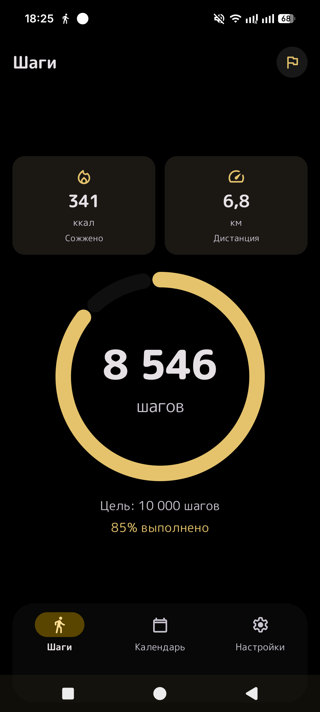
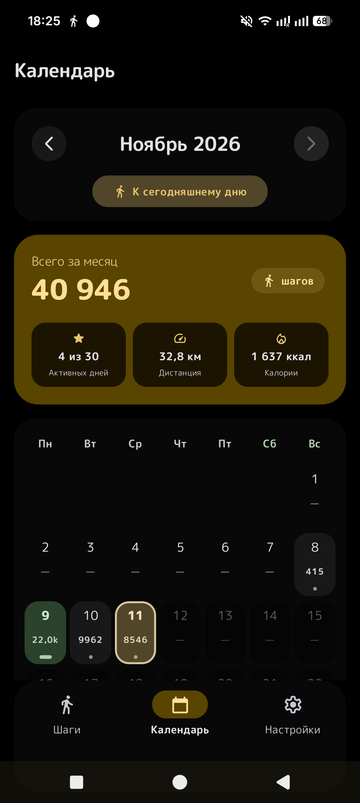
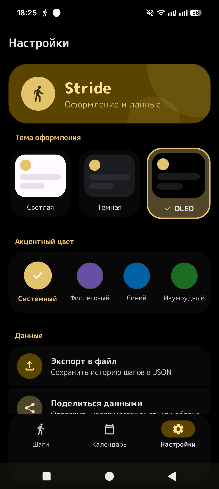

# Stride

Простой и энергоэффективный шагомер для Android, написанный на Kotlin и Jetpack Compose.

## Скриншоты

<p align="center">
  
  
  
</p>

## Основные возможности

- **Фоновый подсчёт шагов**: использует аппаратный датчик шагов устройства (`TYPE_STEP_COUNTER`) с минимальным расходом батареи. При его отсутствии задействуется резервный расчёт по акселерометру.
- **Дневной прогресс**: отображение шагов за сегодня, процент выполнения цели, расчёт расстояния (км) и потраченных калорий (ккал).
- **Календарь и статистика**: просмотр истории активности по дням и суммарные показатели за месяц (шаги, километраж, калории, активные дни).
- **Гибкая цель**: возможность задать персональную дневную цель шагов в один клик.
- **Экспорт и импорт**: сохранение всей истории в файл JSON и восстановление данных при смене устройства.
- **Темы оформления**: поддержка светлой, тёмной и чистой черной (OLED) тем, а также выбор акцентного цвета интерфейса.
- **Приватность**: приложение не требует регистрации и не отправляет данные на внешние серверы — всё хранится только локально.

## Стек технологий

- Kotlin, Coroutines, Flow
- Jetpack Compose, Material 3
- Foreground Service для фонового учёта
- SharedPreferences для локального хранения

## Сборка проекта

Требуется JDK 21.

```bash
# Сборка отладочного APK
./gradlew assembleDebug

# Запуск юнит-тестов
./gradlew testDebugUnitTest
```
